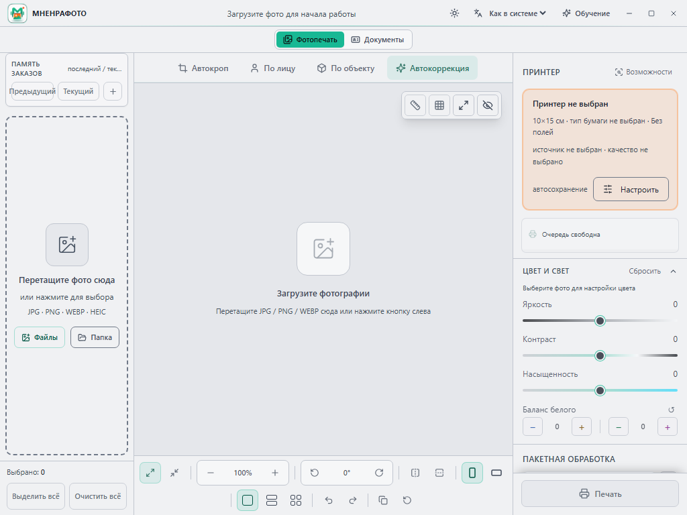
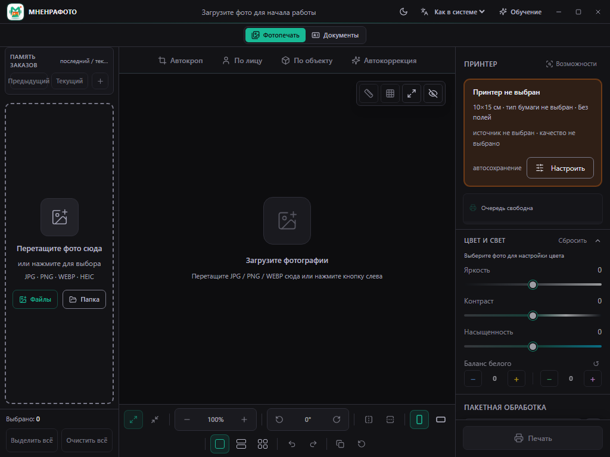

# MNENRAFOTO

Free Windows app for fast photo preparation and printing.

> **Current version:** 0.2.0 Alpha 3<br>
> **Status:** public testing<br>
> **Platform:** Windows 10/11, 64-bit

[Русская версия](README.md)

[](https://github.com/madeinsuslov/mnenrafoto-releases/releases/download/v0.2.0-alpha.3/MnenraFoto-0.2.0-alpha.3-win-x64-setup.exe)
[](https://github.com/madeinsuslov/mnenrafoto-releases/releases/download/v0.2.0-alpha.3/MnenraFoto-0.2.0-alpha.3-win-x64-portable.exe)
[](https://github.com/madeinsuslov/mnenrafoto-releases/releases/tag/v0.2.0-alpha.3)
[](https://github.com/madeinsuslov/mnenrafoto-releases/releases/download/v0.2.0-alpha.3/SHA256SUMS.txt)

MNENRAFOTO is a local Windows application for importing, preparing, editing, and printing photos. Photos are processed on the user's computer and are not uploaded to a cloud service.

## What's new in Alpha 3

- System, light and dark appearance modes with live switching and saved preferences.
- More readable labels, controls, menus, dialogs and disabled states.
- Optional 0 / 1 / 2 / 3 / 5 mm photo gaps for 2- and 4-photo layouts, with preview and explicit size confirmation.
- Epson L8050 driver-named paper selection and final paper-size validation before printing.
- Retained release fixes for sheet placement, print progress and GDI job lifecycle.

| Light | Dark |
| --- | --- |
|  |  |

**This is a prerelease. L8050 is not physically verified yet.** Positive gaps currently
require bordered printing. Four exact 100×150 mm photos do not fit a 2×2 grid on A4.
Theme changes do not recolor photos, exports or printed images. Existing profiles
default to dark; new profiles follow Windows appearance.

Close the previous version before updating. Normal Setup/Portable builds share the
existing profile; separate `TEST L8050` builds used an isolated test profile.
Back up important orders/settings and test one sheet before a batch.

[Detailed Alpha 3 notes (Russian)](RELEASE_NOTES_v0.2.0-alpha.3.md).

## Features retained from Alpha 2

- Russian and English UI are available.
- A separate document photo mode was added.
- Supported document photo formats include 3×4, 3.5×4.5, and 4×6.
- Mixed document sheets, crop marks, custom formats, face positioning, and per-copy adjustments were added.
- Finished document sheets can be exported as JPEG, including a preliminary Госуслуги profile.
- The photo printing workflow now includes an active photo counter, a new order command, previous/current order memory, updated white balance controls, and Undo/Redo.
- Paper matching was improved with physical-first matching and separate 15×20 and 15×21 formats.
- PrintTicket and Epson L805/L1210/L1250 scenarios were improved.

## Main features

- file and folder import;
- JPG/JPEG/PNG/WebP/HEIC/HEIF;
- batch processing;
- per-photo adjustments;
- brightness, contrast, saturation, and white balance;
- crop, zoom, pan, rotation, flip, and alignment;
- photo layouts and user presets;
- apply settings to the whole order;
- current and previous order memory;
- regular photo printing and document photo mode;
- JPEG export;
- local processing without cloud upload.

## Download

| Option | Use case |
| --- | --- |
| [Setup](https://github.com/madeinsuslov/mnenrafoto-releases/releases/download/v0.2.0-alpha.3/MnenraFoto-0.2.0-alpha.3-win-x64-setup.exe) | Recommended for most users |
| [Portable](https://github.com/madeinsuslov/mnenrafoto-releases/releases/download/v0.2.0-alpha.3/MnenraFoto-0.2.0-alpha.3-win-x64-portable.exe) | Run without installation |
| [SHA256SUMS.txt](https://github.com/madeinsuslov/mnenrafoto-releases/releases/download/v0.2.0-alpha.3/SHA256SUMS.txt) | Verify downloaded files |
| [Release page](https://github.com/madeinsuslov/mnenrafoto-releases/releases/tag/v0.2.0-alpha.3) | Full Alpha 3 notes and all files |

## System requirements

- Windows 10/11;
- 64-bit;
- installed printer driver;
- minimum 4 GB RAM;
- HEIC may require Windows HEIF/HEVC system extensions.

## Privacy

- Photos are processed locally.
- Photos are not uploaded to the developer or a server.
- User presets and order memory are stored on the user's computer.
- Do not attach other people's personal photos when reporting issues.

## Alpha limitations

- This is a test Alpha version and may contain bugs.
- The installer is not code-signed; Windows SmartScreen may show a warning.
- Print results depend on the printer, driver, paper, and Windows settings.
- Print one test sheet before batch printing.
- Not all printer models are physically verified.
- Some new paper formats need manual testing.
- The Госуслуги profile is preliminary; current service requirements should be checked by the user.
- Face positioning tools will continue to improve.

## Verify downloads

```powershell
Get-FileHash .\MnenraFoto-0.2.0-alpha.3-win-x64-setup.exe -Algorithm SHA256
Get-FileHash .\MnenraFoto-0.2.0-alpha.3-win-x64-portable.exe -Algorithm SHA256
```

Compare the result with `SHA256SUMS.txt` attached to the matching release before running the EXE.

## Feedback

Use [GitHub Issues](https://github.com/madeinsuslov/mnenrafoto-releases/issues). For printing issues, include printer model, Windows version, paper format, driver type, expected result, and actual result.
